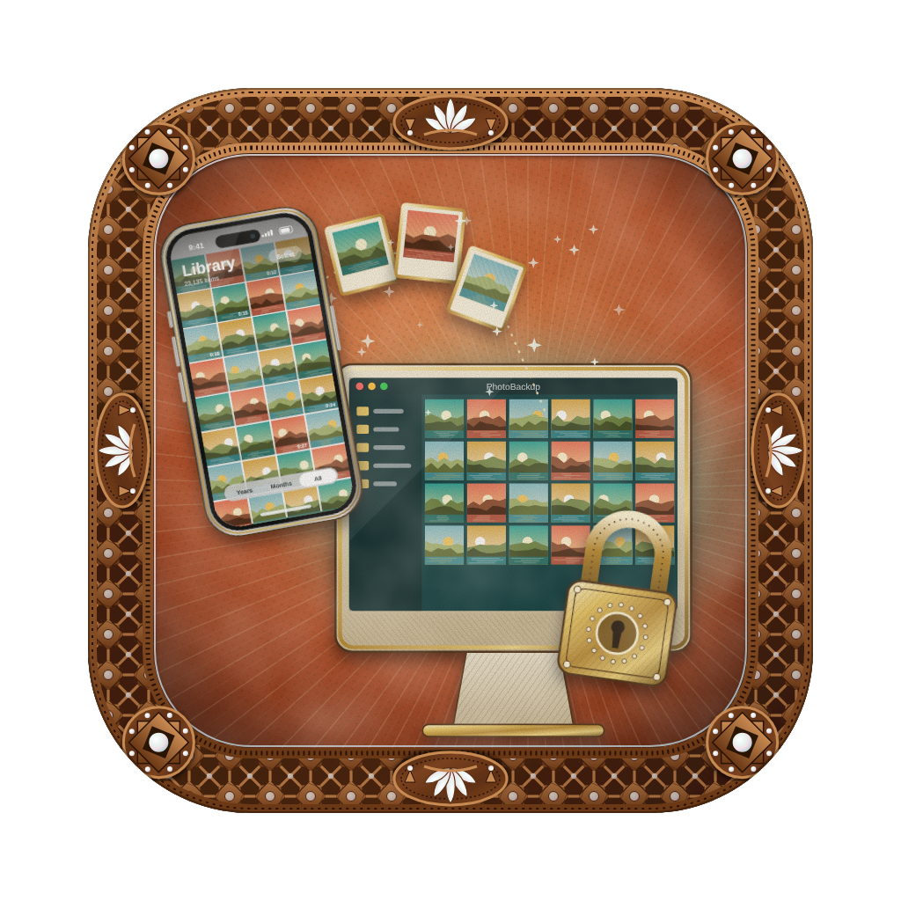

<p align="center">
  
</p>

<h1 align="center">Photo Backup</h1>

<p align="center">
  Back up your iPhone's photos and videos to your Mac over USB, <b>with locations, albums, favorites and captions kept</b>, so you can safely free up space on the phone.<br>
  No iCloud, no Photos app import, nothing ever deleted.
</p>

---

## Features

- **Desktop app.** Connect a phone, browse what's on it, pick what to import, and browse your backup with albums, favorites, Live Photos, videos and screenshots.
- **Metadata kept.** Every photo gets a `.json` sidecar with its date taken, GPS, albums, caption, favorite/hidden flags and source.
- **Incremental.** Re-running copies only what's new, and duplicates are detected.
- **Verified.** Every file is SHA-256 checked after copying. Partial copies never appear under a real name.
- **Safe.** Nothing is ever deleted, on the phone or in the backup. At the end of a run you get a *"safe to delete up to …"* date.
- **Multiple phones.** Each iPhone gets its own folder, matched by its device ID (UDID).
- **Everything on the phone.** Camera roll, photos synced from a computer, iCloud Shared Albums and photos saved from Messages. Recently Deleted is skipped.

> **Platform:** macOS on Apple Silicon. Windows and Intel Macs are not supported yet.

---

## Quick start (desktop app)

### Use a prebuilt app
1. Download `PhotoBackup-<version>.dmg` from **Releases**.
2. Open it and drag **Photo Backup** into **Applications**.
3. The first time you launch it, right-click the app → **Open** → **Open**. On newer macOS versions use System Settings → Privacy & Security → **Open Anyway**. You only need to do this once, because the app isn't notarized by Apple.
4. Plug in your iPhone, unlock it, tap **Trust This Computer**, then pick a backup folder and press **Connect**.

### Build the app yourself

Requirements: macOS on Apple Silicon, Python 3.12 and [uv](https://github.com/astral-sh/uv).

```bash
git clone <this-repo-url> photo-offload
cd photo-offload
uv venv --python 3.12
source .venv/bin/activate

bash build.sh          # installs pinned deps, builds dist/Photo Backup.app, runs a smoke test
bash make_dmg.sh 1.0   # optional: packages it as dist/PhotoBackup-1.0.dmg
```

- `build.sh` builds from `Photo Backup.spec`, which defines the static files, the icon and the bundle ID. It then launches the app for 8 seconds to check that it starts. The log goes to `build/smoke.log`.
- `make_dmg.sh` signs the app with a local (ad-hoc) signature and creates a compressed drag-to-Applications DMG.

### Run from source (no build)

```bash
source .venv/bin/activate
uv pip install -r requirements.txt
python launcher.py                    # opens the app window
# or, in a browser:
uvicorn viewer.app:app --reload       # then open http://localhost:8000
```

---

## Command-line backup

`offload.py` backs up every item on the phone in one run. Keep the phone **unlocked and plugged in** the whole time.

```bash
source .venv/bin/activate
pymobiledevice3 usbmux list         # check the Mac can see the phone

python offload.py --dry-run         # checks + size estimate, copies nothing
python offload.py --limit 20        # test run: only the 20 newest items
python offload.py                   # full run (asks before copying; --yes to skip)
```

Before copying, it checks that:
- the phone is reachable;
- you know what's new and what's only in iCloud;
- the backup drive has enough free space (with a safety margin).

It ends with a summary like this:

```
Copied: 1840  Skipped (already done): 0  Duplicates: 3  Metadata refreshed: 0  Failed: 0
Everything taken up to 2026-10-04 18:22 is verified and safe to delete.
```

To free space on the phone:
1. Delete only photos taken on or before that date.
2. Empty **Recently Deleted**.
3. If `Failed` is above 0, re-run first.

---

## What you get

The backup folder is chosen in the app. It defaults to `~/PhotoBackup`.

```
PhotoBackup/
  <PhoneName>__<UDID>/
    device.json            # name, model, iOS, UDID
    manifest.sqlite        # what's been copied + checksums (used for re-runs)
    db-snapshots/<date>/   # copy of the phone's Photos database per run
    logs/<date>.log        # every warning/error of that run
    media/
      IMG_1234.HEIC
      IMG_1234.MOV         # Live Photo video part
      IMG_1234.AAE         # edits, if any
      IMG_1234.HEIC.json   # metadata sidecar
```

Each file's modified date is set to the date the photo was taken, so sorting by date in Finder shows them in order.

Here is an example sidecar (abridged):

```json
{
  "albums": ["Cairo trip"],
  "caption": "Sunset from the roof",
  "date_taken": "2026-10-04T18:22:10",
  "date_taken_utc": "2026-10-04T15:22:10+00:00",
  "favorite": true,
  "latitude": 30.04,
  "longitude": 31.23,
  "source": "camera_roll"
}
```

---

## Troubleshooting

| Symptom | Fix |
|---|---|
| Phone not found / pairing error | Unlock the phone, replug it and tap Trust. Check with `pymobiledevice3 usbmux list`. |
| `not on phone: …` | The original is only in iCloud (Optimize iPhone Storage). Download originals on the phone, or accept that it's skipped. |
| Run interrupted / cable pulled | Re-run. Unfinished items restart and finished ones are skipped. |
| `size mismatch` / `verification failed` | Usually a flaky cable. Re-run and the item is retried. |
| macOS says the app "can't be opened" | Right-click it → **Open**, or use Privacy & Security → **Open Anyway**. |

---

## Project layout

```
launcher.py      # desktop app entry point (pywebview window + local server)
offload.py       # backup engine + command-line tool
config.py        # settings (backup folder, viewer prefs)
viewer/          # FastAPI backend (app.py, phone.py) + plain-JS frontend (static/)
assets/          # app icon
docs/            # developer guide, design notes, code review
retag.py, check_local.py, count_dcim.py, explain_gap.py   # maintenance / diagnostic scripts
build.sh, make_dmg.sh, Photo Backup.spec                  # packaging
```

For how the code works (modules, functions, HTTP API, data formats), see [`docs/DEVELOPER_GUIDE.md`](docs/DEVELOPER_GUIDE.md).

---

## Privacy

Everything stays on your Mac. The app talks to the phone over USB, and the viewer only listens on `127.0.0.1`, so nothing is uploaded anywhere.

## Contributing

Issues and pull requests are welcome. Please read `docs/DEVELOPER_GUIDE.md` first. Keep changes backward compatible with existing backup folders (`manifest.sqlite` and the sidecar format).

## License

No license has been chosen yet. Add a `LICENSE` file (for example MIT) before publishing.

Built on [pymobiledevice3](https://github.com/doronz88/pymobiledevice3), [FastAPI](https://fastapi.tiangolo.com/) and [pywebview](https://pywebview.flowrl.com/).
